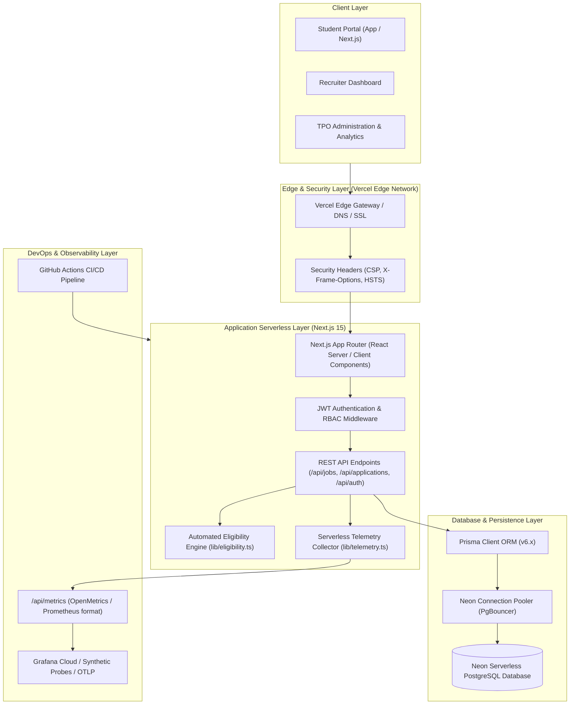
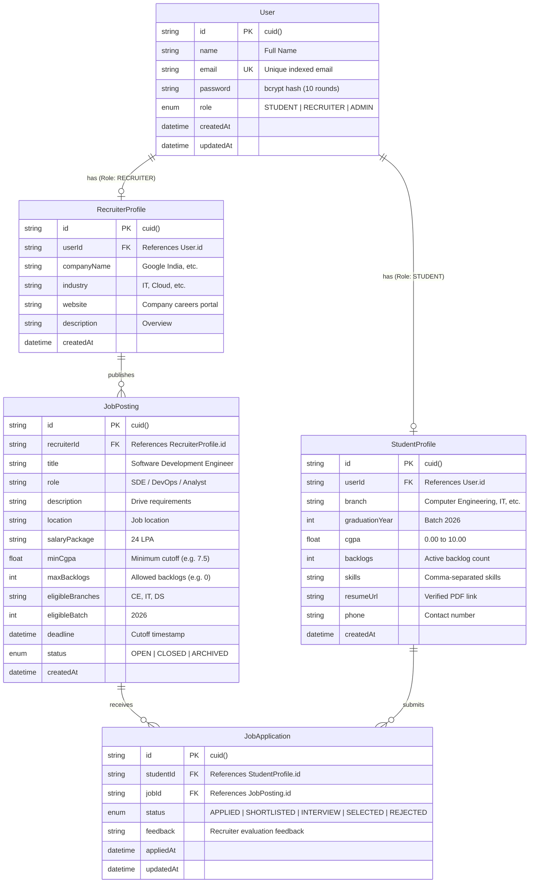
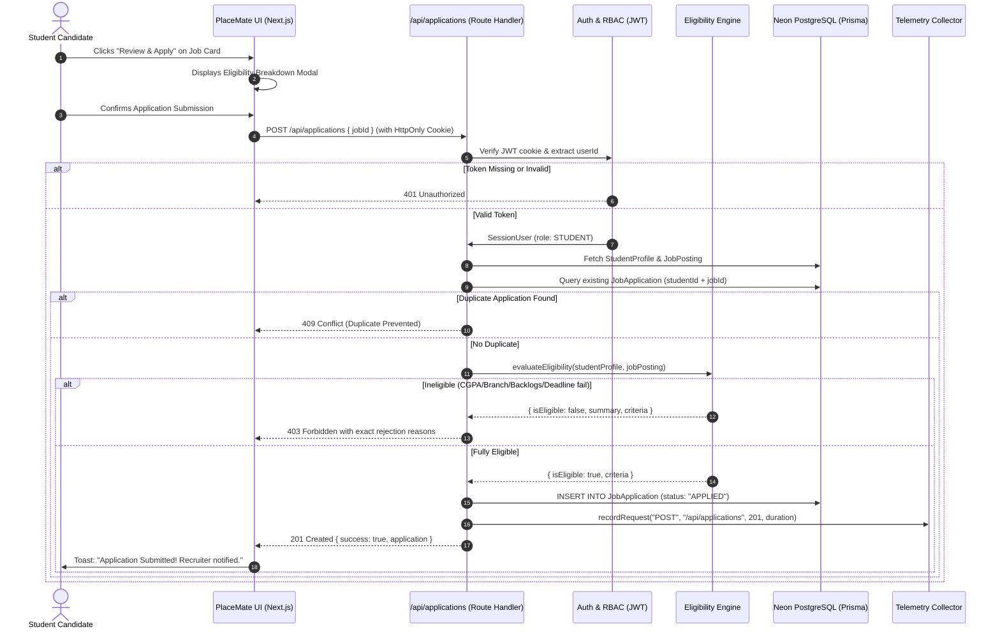

# PlaceMate: System Architecture & Technical Specifications

This document details the architectural design, entity relationships, security controls, and DevOps pipelines of **PlaceMate — Full-Stack Campus Placement Portal with DevOps**.

---

## 1. High-Level Architecture Diagram

---

## 2. Entity-Relationship Diagram (ERD)

---

## 3. Student Application & Server-Side Eligibility Flow

---

## 4. Automated CI/CD Deployment Flow

```mermaid
flowchart LR
    subgraph Developer["Engineering Workstation"]
        GitCommit["git commit -m 'feat: ...'"]
        GitPush["git push origin main"]
    end

    subgraph GitHub["GitHub Actions CI/CD"]
        direction TB
        Trigger["Webhook: Push on main"]
        Install["Step 1: npm ci & prisma generate"]
        Lint["Step 2: ESLint checks"]
        Typecheck["Step 3: TypeScript tsc --noEmit"]
        Tests["Step 4: Vitest Automated Tests (20/20)"]
        Build["Step 5: Next.js Production Compilation"]
        VercelDeploy["Step 6: Vercel CLI Atomic Deploy"]
    end

    subgraph Production["Production Cloud"]
        VercelLive["Vercel Production URL"]
        NeonProd["Neon Serverless PostgreSQL"]
        GrafanaLive["Grafana Cloud Observability"]
    end

    GitCommit --> GitPush
    GitPush --> Trigger
    Trigger --> Install
    Install --> Lint
    Lint --> Typecheck
    Typecheck --> Tests
    Tests --> Build
    Build --> VercelDeploy
    VercelDeploy --> VercelLive
    VercelLive <--> NeonProd
    VercelLive --> GrafanaLive
```

---

## 5. Security Architecture & Threat Mitigation

| Threat Vector | Mitigation in PlaceMate |
|---|---|
| **SQL Injection** | Prisma ORM parameterizes all queries and prepared statements; zero string concatenation. |
| **Cross-Site Scripting (XSS)** | JWT tokens stored exclusively in `HttpOnly` cookies, preventing client JS access. React escapes output by default. |
| **Cross-Site Request Forgery (CSRF)** | Cookies configured with `SameSite=Lax`. API routes require standard JSON payloads with Content-Type checks. |
| **Client-Side State Tampering** | Eligibility rules and candidate qualification records are strictly re-verified on the server inside Route Handlers. |
| **Unauthorized Status Updates** | Recruiter status modifications verify company ownership: `job.recruiterId === user.recruiterProfileId` or platform `ADMIN`. |
| **Duplicate Applications** | Enforced at the database layer via composite `@@unique([studentId, jobId])` constraint and pre-flight application checks. |
